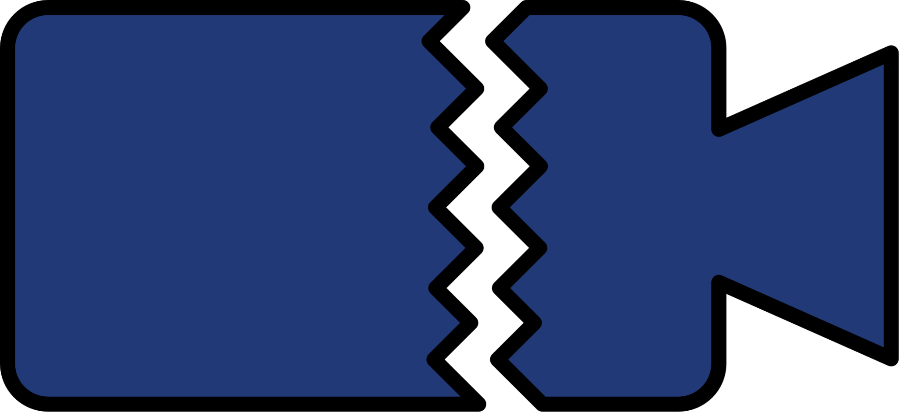

<p align="center">
  
</p>

# Frayme

A web-based tool that recursively scans directories for corrupted video files and offers best-effort recovery.


## What It Does

- **Scans** directories recursively for damaged video files (`.mp4`, `.mov`, `.m4v`, `.m4a`, `.3gp`, `.3g2`, `.avi`)
- **Detects** missing moov atoms, leading-zero corruption, truncated files, empty files, and invalid container structures
- **Recovers** files using raw H.264 NAL extraction with SPS/PPS probing, or moov transplant from a healthy donor file
- **Auto-selects donors** by matching filename prefixes, so directories with mixed devices (GoPro, iPhone, Nikon) are handled
- **Exports** scan results to CSV

## Requirements

- **Python 3.7+** (ships with macOS and most Linux distributions)
- **FFmpeg**: required for recovery and decode verification

| OS | Install FFmpeg |
|----|----------------|
| macOS | `brew install ffmpeg` |
| Linux (Debian/Ubuntu) | `sudo apt install ffmpeg` |
| Windows | `winget install ffmpeg`, plus Python from [python.org](https://www.python.org/downloads/) if you don't have it |

Run `ffmpeg -version` to confirm it's on your `PATH`; Frayme finds it automatically. No pip install or other dependencies are needed.

## Starting and Stopping

Frayme runs as a local web server at `http://localhost:5901` and opens your browser when it starts.

### macOS

Double-click **Frayme.app** in the project folder. Frayme starts in the background (no Terminal window) and your browser opens.

- **First launch:** if macOS asks whether Frayme can access your Downloads folder or a removable volume, click **Allow**. Frayme needs this to scan your videos. If macOS blocks the app outright, right-click it, choose **Open**, and confirm.
- **To stop it or reopen the browser:** double-click Frayme.app again. A dialog says Frayme is already running and offers **Open in Browser** or **Stop Frayme**.
- **Dock shortcut:** drag Frayme.app onto the Dock. Keep the app itself in the project folder, because it uses `frayme.sh` next to it.

Prefer a visible log? Double-click **Frayme.command** instead; it runs Frayme in a Terminal window, and pressing Return there stops it. You can also use the `frayme.sh` commands below.

### Linux

From the project folder:

```sh
./frayme.sh start         # start in the background and open the browser
./frayme.sh stop          # stop it
./frayme.sh status        # check whether it's running
./frayme.sh logs          # follow the server log
./frayme.sh restart
```

Add a port number to `start` or `restart` (e.g. `./frayme.sh start 8080`) to use a different port.

### Windows

From the project folder in Command Prompt or PowerShell:

```sh
python app.py             # start (use "py app.py" if "python" isn't found)
python app.py 8080        # start on a different port
```

Leave the window open while you use Frayme, and press **Ctrl+C** in it to stop. (Under WSL, use the Linux instructions.)

## Usage

1. Enter a directory path in the scan bar (or browse to one)
2. Click **Scan Directory**. Frayme first searches the folder tree for video files, showing how many it has found so far and which folder it's in; on a large drive this step can take a while. It then checks the files in parallel, and results stream in real-time. While a scan runs, only **Cancel** is available; the path box, Browse, Scan, and Recover buttons are disabled until it finishes. Cancel stops the scan within a moment, even mid-way through large files, and keeps the partial results with a note of how far it got.
3. Problematic files are grouped by directory with a status:

   | Status | Meaning |
   |--------|---------|
   | **no_moov** | Missing moov atom; video data exists, but the file is unplayable |
   | **corrupt** | Invalid structure, leading zeros, or no valid container |
   | **truncated** | File cut short (mdat claims more bytes than the file contains) |
   | **empty** | 0-byte file |
   | **error** | Permission or OS-level read error |

   HEIC/HEIF/AVIF photos saved with a video extension (common inside Photos libraries) are recognized as still images and skipped, not reported as damaged videos.

4. Once the scan finishes, click **Recover Video** on any file, and Frayme auto-selects a compatible donor from healthy files found during the scan. Recoveries run one at a time in the **Recovery Queue** panel (bottom right), which shows each job's progress; **Clear Done** removes finished and failed jobs, and is greyed out until something has finished. If a recovery fails, the row shows the reason and the button changes to **Retry Recovery**
5. Export results to CSV at any time

## How Recovery Works

### Raw NAL Extraction (Primary Strategy)

When a video has raw media data (`mdat`) but is missing its metadata index (`moov`):

1. Scans the mdat for length-prefixed H.264 NAL units
2. Collects all unique SPS/PPS parameter sets from healthy files in the same directory
3. **Probes each candidate** by test-decoding against the actual video data to find the correct resolution match
4. Trims to the first IDR keyframe (skips orphaned P/B-frames that cause playback failures)
5. Filters out zero-corrupted NALs and skips subsequent frames until the next keyframe
6. Wraps the clean Annex-B stream with FFmpeg at the correct framerate

### Moov Transplant (Fallback)

If raw NAL extraction isn't possible, grafts the moov atom from a healthy donor file and adjusts chunk offset tables to match.

### Leading Zeros Recovery

For files with zeroed-out headers, Frayme tries multiple strategies in order:

1. **Moov-at-end recovery**: if the moov survived at the end of the file, trims damaged chunks and rebuilds
2. **MP4 structure survival**: extracts valid boxes after the zero region
3. **Raw NAL extraction**: same pipeline as no-moov recovery, using donor SPS/PPS
4. **Zero strip**: last resort

## Project Structure

```
video-integrity-scanner/
  app.py            # Server, scanner, and recovery engine
  index.html        # Web UI
  logo.svg          # App logo (source for all icons)
  favicon.*, apple-touch-icon.png   # Browser icons, generated from logo.svg
  js/app.js         # Frontend JavaScript
  css/styles.css    # Stylesheet
  frayme.sh         # Start/stop/status script (macOS, Linux)
  Frayme.app        # macOS double-click launcher (no Terminal window)
  Frayme.command    # macOS double-click launcher (Terminal window)
  launcher/         # Frayme.app source and icon generator
```

Zero build step. No npm, no pip, no bundler.

### Changing the Logo

After replacing `logo.svg`, run this on a Mac to regenerate the app icon and browser icons:

```sh
launcher/build-app.sh
```

The web header picks up the new `logo.svg` immediately; the icons only change after this step. The rebuilt Frayme.app will ask for Downloads access again on its next launch. Browsers cache icons, so you may need to close and reopen the Frayme tab to see the new one.

## Limitations

- Recovery is best-effort and depends on having a compatible donor file
- Recovered files are video-only (audio tracks are not recovered)
- Files with corrupted mdat (actual video data damage) will have gaps at keyframe boundaries
- Multi-mode cameras (e.g., GoPro 4K and 1080p) require SPS probing to match the correct resolution

## Built With

This project was built with [Claude Code](https://claude.ai/code).

## License

MIT
